# Design

How easyCall's code fits together: the pieces, the rules they follow, and the main flows as
sequence diagrams. For what the app is for and how to set it up, see the [README](../README.md).

## Overview

easyCall lets family members (**callers**) video call one person (the **receiver**) on a tablet
that needs no interaction during a call. Each family is a **group** with its own URL
(`/<group>/`), its own members, and exactly one receiver.

Everything runs on Cloudflare:

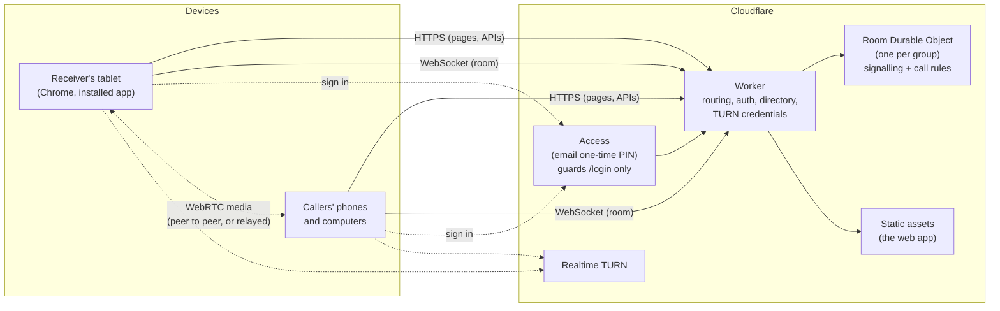

- **One Worker** serves the pages, the APIs and the WebSocket upgrade. There's no Cloudflare Pages.
- **One Durable Object per group** (`env.ROOM.getByName(group)`) holds that group's WebSocket
  connections and enforces the call rules. Groups never share anything.
- **Media goes directly between the devices** over WebRTC. It's relayed through Cloudflare TURN only
  when there's no direct path. The Worker and the room only carry signalling.

## Principles

- **Pure logic, thin adapters.** The rules live in pure functions with no I/O (`room-state.ts`,
  `call-status.ts`, `directory.ts`, the protocol parser). The Durable Object, the DOM views and the
  WebRTC wrapper are thin shells around them. Most of the behaviour is therefore unit tested without
  a browser or network.
- **Effects as data.** The room's state machine returns the new state plus a list of **effects**
  (send a message, close a connection, start or stop a timer). The Durable Object carries them out.
- **Trust the server, not the browser.** The role, email and name come from the session and the
  directory. The browser only supplies a random page id, which is used just to tell apart pages
  signed in as the same person.
- **Clean vs unclean exits.** A deliberate exit is an explicit `hangup` message and takes effect
  immediately. A lost connection holds the person's place for a grace period, so a network blip or
  a deploy doesn't end a call. WebSocket close codes aren't trusted for this.
- **Few dependencies.** Plain TypeScript and DOM, no UI framework. `jose` is the only runtime
  dependency.

## Code layout

| Path                            | What's there                                                             |
| ------------------------------- | ------------------------------------------------------------------------ |
| `src/shared/protocol.ts`        | Every message on the room socket, plus `parseMessage` for untrusted JSON |
| `src/shared/`                   | Roles, ICE server types, the `Me` response, the build version            |
| `src/worker/index.ts`           | Routing and authentication for every request                             |
| `src/worker/room-state.ts`      | The room's pure state machine                                            |
| `src/worker/room.ts`            | The Durable Object shell: sockets, storage, timers (one alarm)           |
| `src/worker/directory.ts`       | Groups and members, read from the `DIRECTORY` secret                     |
| `src/worker/session.ts`         | Our signed session cookie                                                |
| `src/worker/access.ts`          | Verifying Cloudflare Access's token at `/login`                          |
| `src/worker/turn.ts`            | Short-lived TURN credentials                                             |
| `src/worker/home.ts`            | The home page (`/`)                                                      |
| `src/worker/manifest.ts`        | The installable app's manifest, per group and role                       |
| `src/client/main.ts`            | Asks who you are, then mounts the receiver or caller view                |
| `src/client/sessions.ts`        | What both sessions share: their dependencies, starting the camera        |
| `src/client/*-session.ts`       | The receiver's and caller's call logic (room messages, peer, recovery)   |
| `src/client/*-view.ts`          | The screens: a `State` union and a `render()` that rebuilds the content  |
| `src/client/room-connection.ts` | The room WebSocket, reconnecting with backoff                            |
| `src/client/api.ts`             | Asking the Worker who you are and for ICE servers; the room's URL        |
| `src/client/peer.ts`            | A thin wrapper around `RTCPeerConnection`                                |
| `src/client/call-status.ts`     | Maps connection states to "Connecting…" / "Reconnecting…"                |
| `src/client/updates.ts`         | Reloads long-open pages to a new deploy, but only when idle              |
| `src/client/wake-lock.ts`       | Keeps the screen on while in use                                         |
| `e2e/`                          | Playwright tests: real browsers with fake cameras against the built app  |
| `scripts/`                      | Uploading the directory, rendering icons                                 |

## Requests and auth

### Routes

| Path                            | Who                                      | What                                                       |
| ------------------------------- | ---------------------------------------- | ---------------------------------------------------------- |
| `/`                             | Anyone                                   | Home page; signed-in members are redirected to their group |
| `/login`                        | Guarded by Access                        | Verifies Access's token, sets our session cookie           |
| `/dev-login`                    | Only with `DEV_LOGIN=true`, on localhost | Local sign-in without Access                               |
| `/version`                      | Anyone                                   | The deployed version, so open pages can update             |
| `/<group>/`                     | Members                                  | The app (the same page for every role)                     |
| `/<group>/manifest.webmanifest` | Members                                  | The installable app, for your role                         |
| `/<group>/api/me`               | Members                                  | Your role and name, and the receiver's name                |
| `/<group>/api/ice-servers`      | Members                                  | STUN/TURN servers for a call                               |
| `/<group>/api/room`             | Members                                  | WebSocket to the group's room                              |

A group route without a session redirects to `/login` (pages) or returns 401 (APIs), whether
or not the group exists, so nobody can find out which groups do. Once signed in, a non-member gets
404, as does anything unknown. The room only accepts WebSockets whose `Origin` is the app's own.
After signing in, `next` is resolved the way a browser would and only kept if it's on this site.
Built assets and icons are served without running the Worker.

### Signing in

Cloudflare Access guards only `/login`. Once through, the Worker issues **its own** session
cookie, valid for a year and renewed on use. This avoids Access's one-month maximum session, which
would make the tablet show a sign-in screen every month.

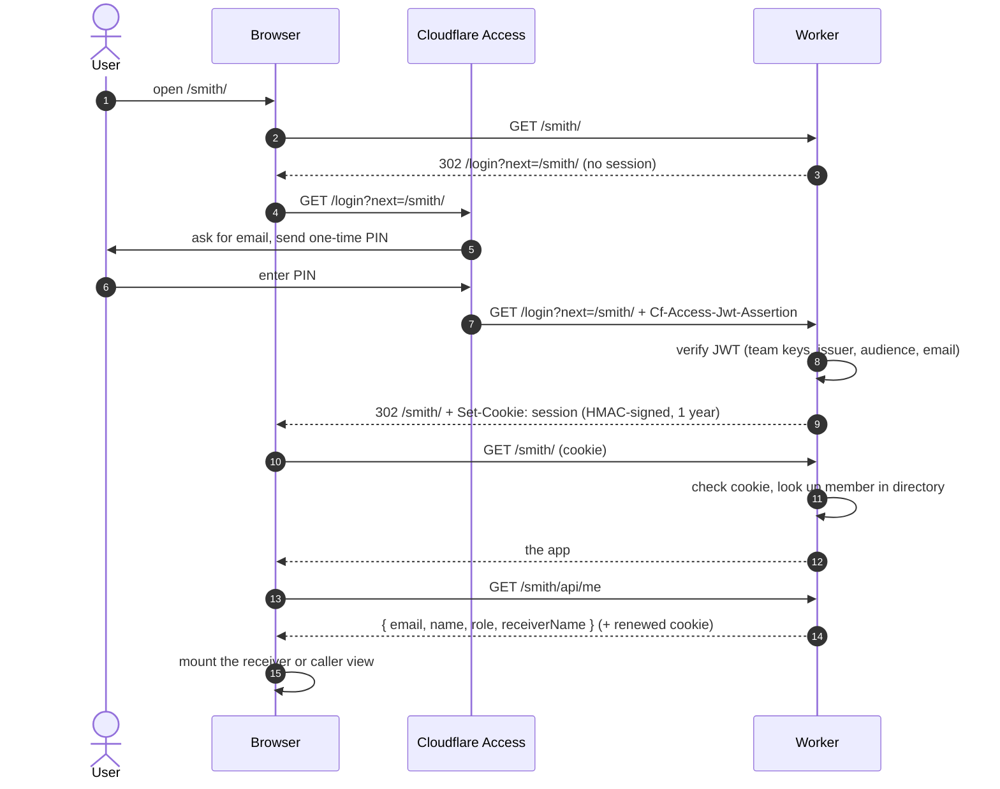

Every request checks the session and looks up the user's role in the directory, so removing
someone from the directory removes their access immediately. Rotating `SESSION_SECRET` signs
everyone out.

### The directory

The `DIRECTORY` secret is JSON listing each group's members (`email → { role, name }`). It's
uploaded from a local, gitignored `directory.json` by `npm run directory:push`, which validates it
with the same rules the Worker uses:

- Every member needs a role (`receiver`, `caller` or `admin`) and a name.
- Each group has exactly one receiver, whose name is what callers see the group as.
- Each person is in at most one group, so `/` can send them straight to it.

Code only reads it through the `Directory` interface, so the storage can move (to D1, say)
without touching the rest of the app.

## The room

### State

```ts
interface RoomState {
  receiver: Participant | null; // the tablet
  callers: Caller[]; // every connected caller, in the call or not
  active: ActiveCaller | null; // the caller in the call
}
```

A **participant**'s `connection` is `null` while they're **away**: their connection dropped
without a `hangup`, and their place is being held. The active caller also has the `page` they
joined from and a `call` id.

The transitions are `connect`, `receive` (a message), `disconnect` and `expire` (a timer ran out).
Each returns `{ state, effects }`. A final `finish()` step compares the before and after states and
adds the knock-on effects:

- a status message to each caller whose view of the status changed
- starting or stopping each timer as its condition begins or ends

So the state machine needs no clock.

| Timer           | Runs while                                    | When it runs out                       |
| --------------- | --------------------------------------------- | -------------------------------------- |
| `ready`         | The receiver is waiting and nobody has called | The receiver gets `timeout` and leaves |
| `receiver-away` | The receiver's connection has dropped         | The receiver is gone; any call ends    |
| `caller-away`   | The active caller's connection has dropped    | The call ends                          |

The ready window is `READY_WINDOW_MINUTES` (default 30). The grace periods are `GRACE_SECONDS`
(default 30).

### Status as callers see it

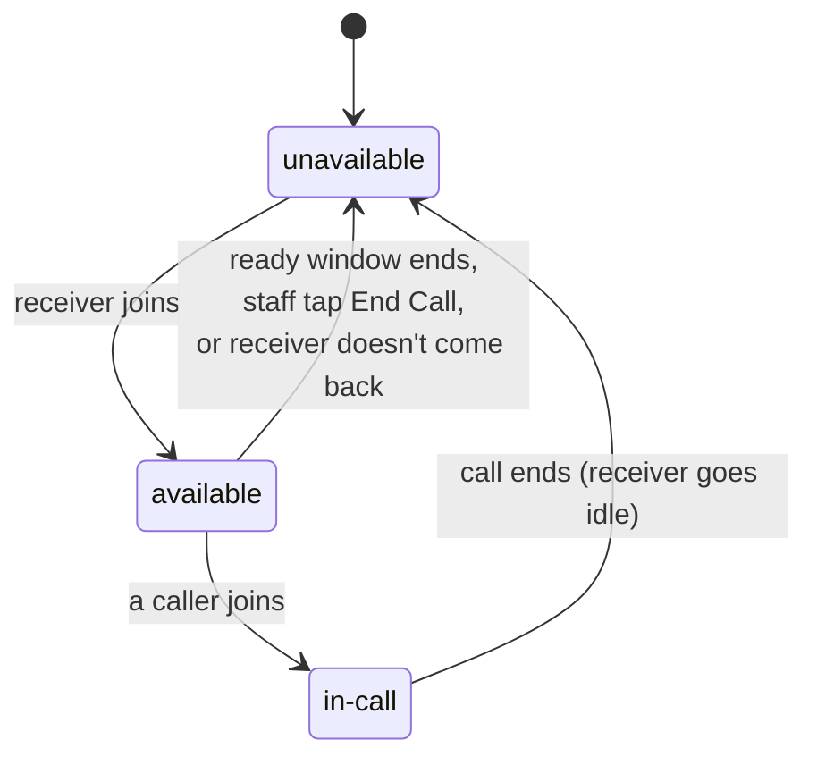

During a call the status names who's in it. If it's **your** call and you're away (for example,
you closed the app), it also says `rejoin: true`.

### The Durable Object shell

`room.ts` uses the WebSocket Hibernation API, so an idle room costs nothing. Each socket's
attachment holds its `{ id, role, email, name, page }`. The state is saved in the object's storage
after every transition. Timers are deadlines in storage, with a single Durable Object alarm set
for the earliest one.

When it loads, the state is **checked against the live sockets**. A restart (such as a deploy)
drops every socket without close events. So callers whose socket has gone are forgotten, and
participants whose socket has gone are marked away and their grace timers started. They reconnect
within a second or two, so a deploy doesn't end a call.

## Calls

The caller always makes the WebRTC offer and the receiver always answers, so there are never two
offers at once. Signals (`offer`, `answer`, `candidate`) only flow between the receiver and the
active caller. Anything else is dropped.

### Making a call

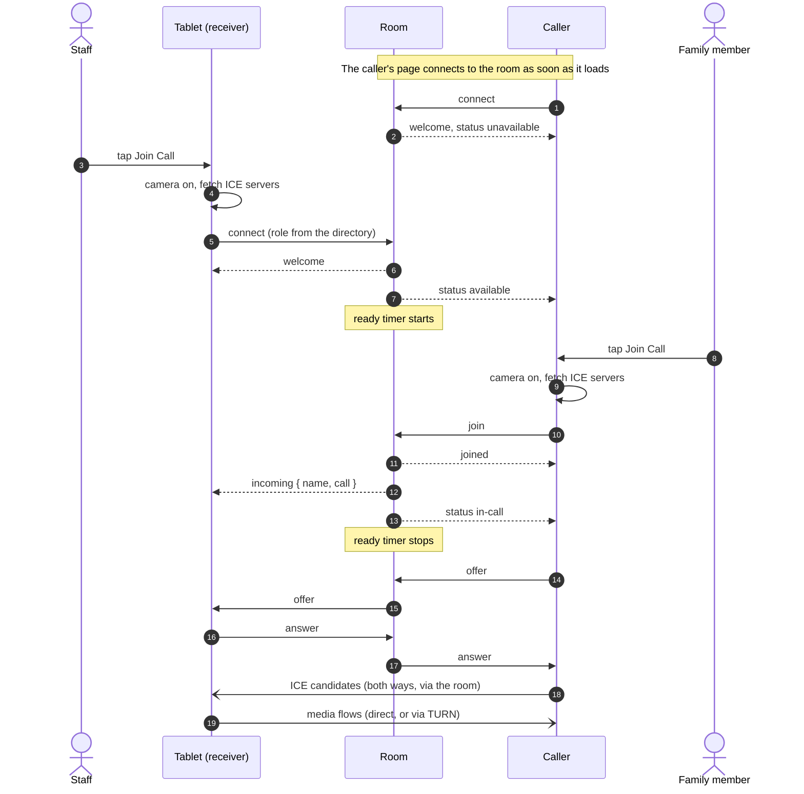

The tablet answers automatically: there's nothing to tap once someone's calling. A second caller
who presses Join Call while a call is in progress is sent `refused`.

### Ending a call

A deliberate end is an explicit `hangup`. After a call ends, the tablet goes back to idle with the
camera off, and stays unavailable until staff tap Join Call again.

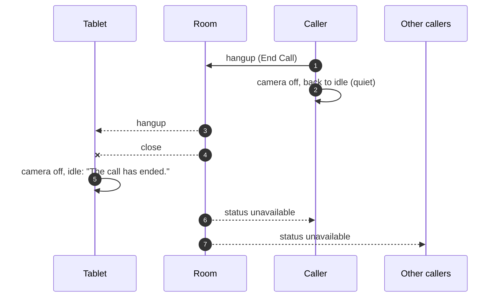

Staff can also stop the tablet waiting before anyone calls. **End Call** on the waiting screen
sends `hangup` from the receiver, and the room clears the receiver straight away. Without the
explicit message, callers would go on seeing "ready for a call" for the grace period.

### Nobody calls

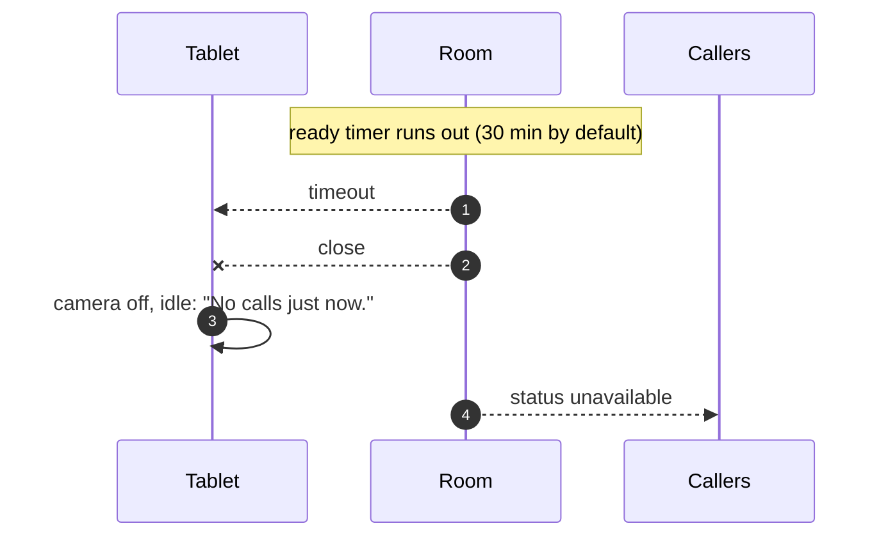

## Staying connected

### The room connection

`room-connection.ts` reconnects after an unexpected close, waiting 1, 2, 4, 8 and then every
15 seconds. A close with code 4000 or above means the room closed it on purpose (for example, the
tablet was opened somewhere else), and isn't retried. Each (re)connection starts with
`welcome { resumed }`, which says whether the room kept your place.

### A dropped connection mid-call

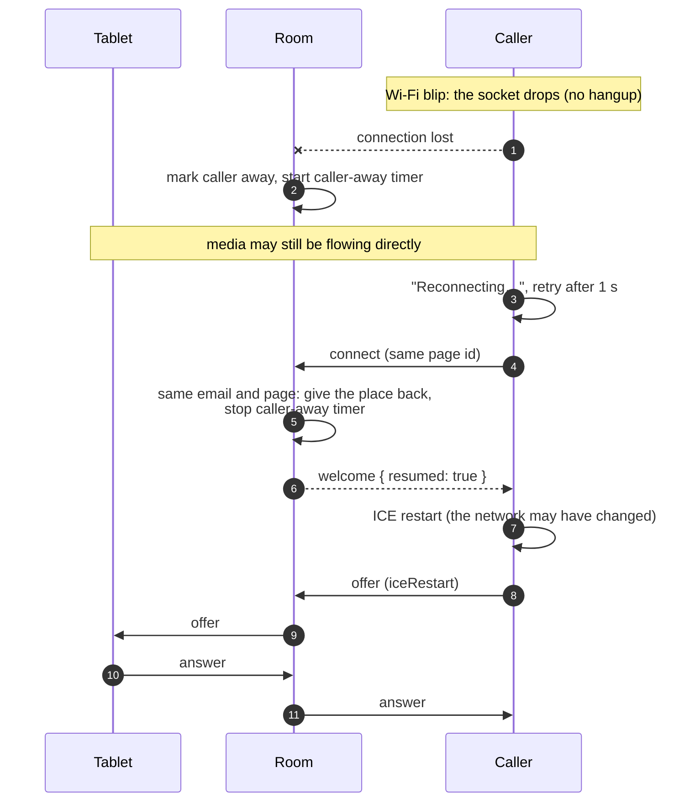

If the caller doesn't come back within the grace period, the call ends as if they'd hung up. The
tablet works the same way: it reconnects by email, and the room sends it `incoming` again so a
reloaded tablet knows who's calling.

### When the media breaks

The caller watches the peer connection. It restarts ICE straight away on `failed`, and after
3 seconds of `disconnected` (unless it recovers by itself). If a call has no working media for
30 seconds, the caller gives up: it sends `hangup` and shows "Couldn't connect" or "The call was
cut off". Both screens show "Connecting…" until media first flows, and "Reconnecting…" while it's
interrupted. The notice is updated in place, so the videos don't flash.

### Reopening the app mid-call

Pages are told apart by a random id that each page load sends with its room connection. Only the
**same page** gets its place back automatically. A new page for the same person (the app closed
and reopened, or another device) can only take over a call that's been dropped, by pressing
**Re-join Call**:

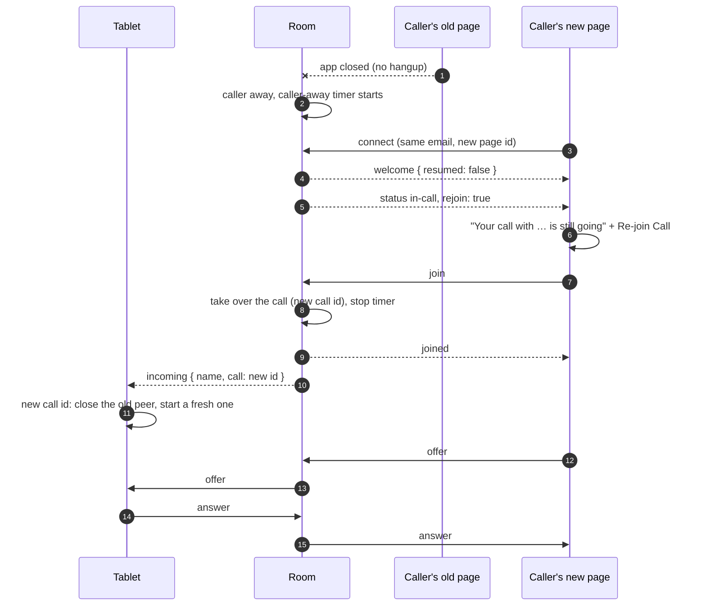

If the old page comes back afterwards, it isn't recognised (`resumed: false`), so it ends its own
copy of the call.

## Screens

The views are plain DOM. Each has a `State` union and a `render(state)` that rebuilds its content
with `replaceChildren`. The notice on the call screens is updated in place instead.

### Tablet (receiver)

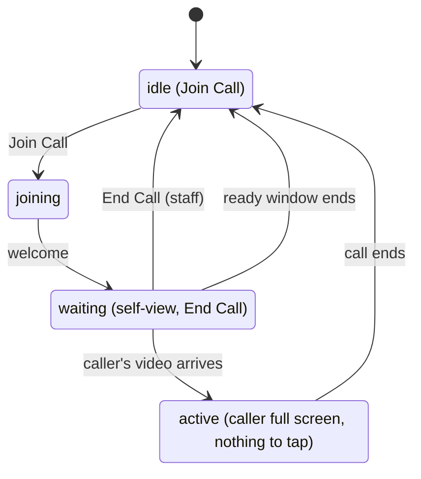

The installed app is always full screen. The page never toggles full screen itself, because
Chrome shows a distracting notice each time. The screen is kept awake while waiting and in a call.

### Caller

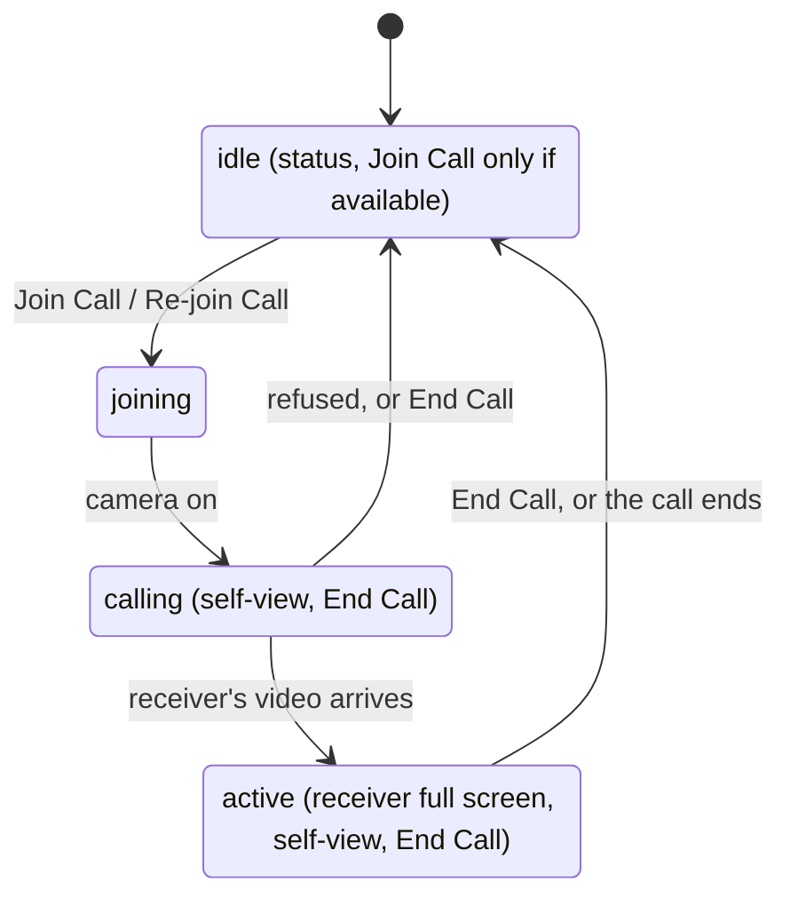

## Keeping devices up to date

There's no service worker, so opening or reloading a page always gets the latest deploy. Pages
left open (like the tablet) hear the deployed version in the room's `welcome`, and also check
`/version` every 10 minutes and when they become visible. Once out of date, a page reloads itself,
but only after a minute back on its idle screen, never while it's in use.

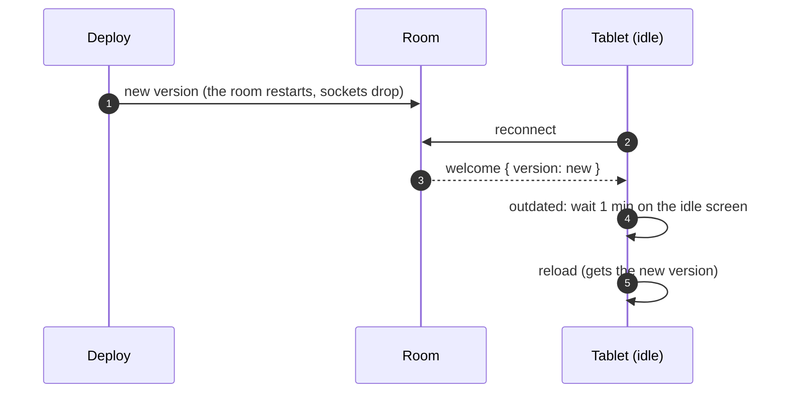

## Testing

- **Unit tests** (Vitest) run as two projects. The Worker and shared code run inside workerd. The
  client code runs in happy-dom, with fake sockets, cameras and peers (`test-fakes.ts`).
- **End-to-end tests** (Playwright, Chromium only) run two or more browser contexts with fake
  cameras against the built app. Each test gets its own group. A group isn't reused until its
  previous test's grace period has passed, because a room holds dropped participants' places.
  Rooms start empty every run.
- **Acceptance tests** on real devices and networks are in [manual-tests.md](manual-tests.md).
- `npm run check` runs all of it, plus type checks, lint and formatting. A change isn't done until
  it passes.
